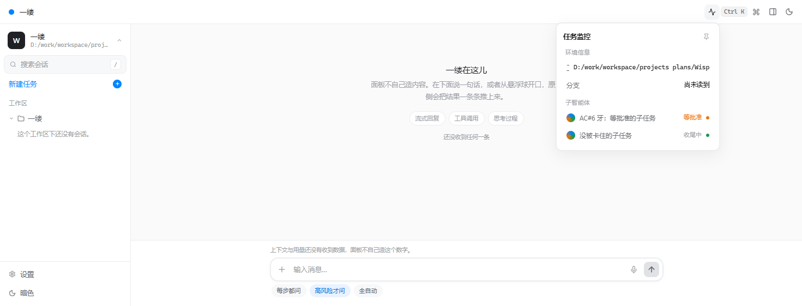

# 票 219 AC#6 —— 名册「等批准」前端半：任务监控真消费 snapshot.tasks（写腿收件表）

> 2026-11-08 15:0x，写腿（frontend 波，票 219 AC#6 的**页面半边**）。
> AC#6 票面原文＝「L1 与 L2 分表：L1 短窗口里等的任务在名册上今天恒读『没被卡住』（账 `A416` 那一格）⇒ 本票要么把它一起修掉、要么具名写『这一支没修、留在票 197/211』」。
> Go 侧的 join（L1 窗口枚举＋同任务第二卡改名）**已由票 220 修掉**（`internal/panel/subagent_roster_197.go` 的 `taskRosterSectionFrom` 收 `l1Windows []L1WindowWait`，`indexWaitingKey` 三个 id 族；现 HEAD 实弹 `blockedOnApproval:true` 配 `pending:[]`，220 腿 2026-11-08 现跑证）。
> **本腿修的是它下游断掉的那一跳**：字节到了页面，页面没人看——本波起手现跑 `grep -rn "\.tasks" frontend/src/` ＝ **0 命中**、`frontend/src/App.tsx:246` 喂死空数组，即推送名册在界面上零到达，「等批准」在 UI 上没有那一档。
> 本表只记**盘上可复跑的读数**；引用行号均为本波现跑 grep/sed 核对过的现值。

## 1. 落了什么

| 件 | 性质 | 内容 |
|---|---|---|
| `frontend/src/App.tsx` | 生产接线（一处） | 新增导出的 `monitorAgents(snapshot.tasks)` 派生（wire 字段逐字段照搬），`MonitorPopover` 从喂死空数组改为喂真名册，并传 `rosterPresent={snapshot.tasks !== undefined}` |
| `frontend/src/components/harness/monitor-popover.tsx` | 生产改形 | `MonitorAgentRow` 从 demo 三态（running/done/failed）改为 **wire 形**（`taskId/label/blockedOnApproval/status/statusKnown/statusReason`，照 `internal/panel/subagent_roster_197.go` TaskRowView 的 json 名，不猜不判）；**等批准（blockedOnApproval）成独立显示档**：显示「等批准」＋warn 点，压过 D43 状态字；二十名 D43 中文表（`internal/statemachine/states.go` 现读的 20 枚）画在画它的组件里（照 App.tsx `TIER_NAMES` 先例，零新造词）；`statusKnown=false` 显示宿主原句（fail-closed，不替任务编状态）；零行时「宿主没带名册」与「还没有子任务」分两句诚实空态 |
| `frontend/scripts/render-task-roster.tsx` | 新牙（`npm run render:roster`） | 派生逐字段读数＋四齿（等批准／正常态／未登记态／空态）＋零 emoji＋源级接线，详 §2 |
| `frontend/package.json` | 脚本一行 | 加 `render:roster` |
| `docs/evidence/s1/219-ac6-task-roster-ui-live.png` | 活体证据 | 同一 bundle 供真 Chromium，推一枚含 `blockedOnApproval:true` 的快照、点开任务监控的截图，详 §3 |
| 本件 | 裁决表 | 读数与诚实边界 |

⛔ 没动：`cmd/wisp/**`（另一腿在飞）、`internal/**` 产码、`internal/ball/**`、`design/**`、`PLAN.md`/specs、thresholds/golden。
现跑核过：`git status --porcelain --untracked-files=no` 里我的写面只有上表前端四枚＋证据两枚；`internal/plugin`、`internal/speech`、`internal/tools` 五枚 M 是**别人的在飞件**（本波零碰）。

## 2. 门禁与新牙读数（全部本波现跑）

| 门禁 | 读数 |
|---|---|
| `npm run typecheck`（tsc -b） | **rc0** |
| `npm run build`（tsc -b＋vite build，bundle 落 dist） | **rc0**（628.12 kB chunk 警告为既有） |
| `npm run render:roster`（新牙） | **rc0，全绿**（逐条见下） |
| `npm run render:receiver`（既有牙复跑，防本腿踩坏 329 页面半边） | **rc0** |
| `npm run lint`（oxlint） | **rc0**（0 errors；36 warnings 皆既有类——`\w` 转义与 RB_MONITOR 导出为改形前就有，本腿新增 1 枚 `only-export-components`＝组件文件导出 `monitorAgents`，与既有 RB_MONITOR/演示导出同类） |
| `sh scripts/d22scan.sh`（导出树） | **clean rc0**（963+241 Go＋frontend 120 text files；日志 `/d/tmp/wisp/20261108/219ac6-ui-d22scan.log`） |
| `gofumpt` | **不适用**（本腿零 Go 产码） |
| LF | 四枚改动文件现跑字节核 CRLF=0 |

新牙四齿（每齿都断言**不出现**的东西，不是只断言出现）：
1. **等批准**：`blockedOnApproval:true` 的行（status 明知是 `Acting`）显示「等批准」＋warn 点，且**不显示**「执行中」（等批准压过 D43 字）；
2. **正常态**：`blockedOnApproval:false` 显示 D43 字「执行中」＋accent 点，不显示「等批准」；
3. **未登记态**：`statusKnown:false` 显示**宿主原句**「宿主没有给出这一维的读数（fail-closed：不替任务编一个状态）」＋idle 点，四枚 D43 词全不出现；
4. **空态**：无 `tasks` 键 ⇒「还没收到名册（宿主没带任务这一节）」；键在、行空 ⇒「还没有子任务在跑」——两句分开，`lib/panel.ts` 的「无读数≠空读数」规则照搬。
另两枚源级钉：App.tsx 必含 `agents={monitorAgents(snapshot.tasks)}` 且**不再含**死空数组喂法；等批准必须派生自 `row.blockedOnApproval`（不是从任何状态词猜）。

## 3. 活体证据（同一 bundle 供真 Chromium）

本机 wisp 的 WebView2 面板白窗属环境问题（账 A1631 一族），按派单用浏览器供活体：
`npm run build` 的 dist 经 `vite preview` 供出，真 Chromium 加载后对页面调 `window.wispOnPanelSnapshot(<快照>)`（**同一扇接收门**，33b264d70 落的那枚全局）推一枚
`tasks.rows` 含 `blockedOnApproval:true`（status=Acting）与 `blockedOnApproval:false`（status=Settling）各一枚的快照，点顶栏「任务监控」，截图：

- 弹层实文（Chromium `innerText` 现读）：「AC#6 牙：等批准的子任务 / **等批准**」「没被卡住的子任务 / **收尾中**」——
  blocked 行读出「等批准」而非「执行中」，free 行读出 D43 字「收尾中」，与牙的断言一致；
- 边界如实：这是**页面消费跳**的活体，不是 wisp.exe 端到端——快照由证据程序推入，未经 Go 泵真推
  （Go→页面那跳的活体归 329/33b264d70 的账；本机 WebView2 白窗见 A1631，端到端真推等那枚环境账清）。

## 4. AC#6 的裁决建议（裁决者≠实现者，框不由本腿翻）

- **页面半边（本腿）**：名册已上屏、等批准已成档、blocked 与 free 两态分得开——盘上读数齐（§2/§3）。
- **Go 半边（票 220 已落）**：L1 窗口＋改名卡两族 join 都进了 `blockedOnApproval`；实弹 `blockedOnApproval:true` 配 `pending:[]` 即 L1 窗口支路在打。
- **残留缺口（具名，不属本腿写面）**：名册池号（`inFlightSlots/poolCap`）与流截断三数（`streamTruncated/streamElidedRunes/streamDropped`）**本腿未画**——弹层只画行名＋状态档，那六枚字段已到页面（wire 形里带着）但界面上还没有落点；属名册显示的下一张票，不是 AC#6 的「等批准可见」格。
- **AC#6 框保持未勾**：按规矩由非实现者按本表现跑复认后再裁。
